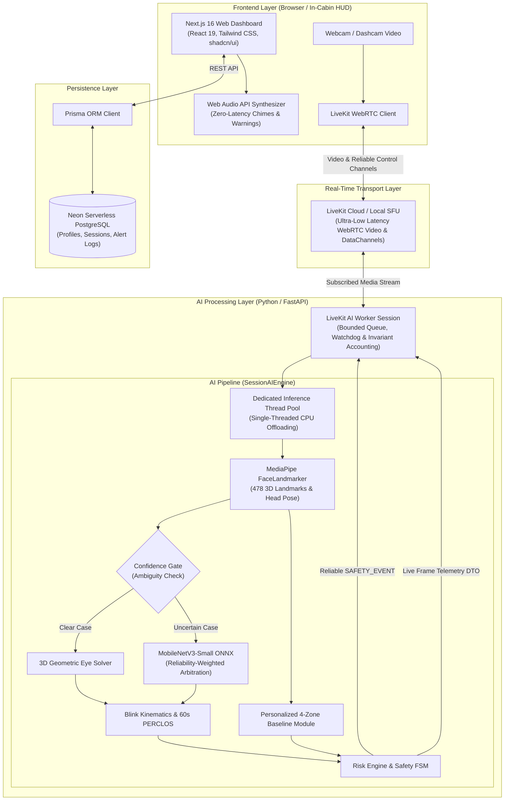

<div align="center">

# 🚗 DriveGuard
### **Personalized Adaptive AI Driver Drowsiness Detection & Early Warning System**

*A full-stack, real-time driver monitoring system combining edge computer vision, personalized facial baselines, and confidence-gated AI to prevent fatigue-related road accidents.*

[](https://www.python.org/)
[](https://fastapi.tiangolo.com/)
[](https://nextjs.org/)
[](https://react.dev/)
[](https://www.typescriptlang.org/)
[](https://developers.google.com/mediapipe)
[](https://onnxruntime.ai/)
[](https://livekit.io/)
[](https://neon.tech/)
[](docs/05_embedded_hardware_subsystem.md)

</div>

---

## 1. Project Introduction

**DriveGuard** is an intelligent, real-time driver monitoring platform designed to detect driver drowsiness and fatigue before it leads to critical road incidents. 

Traditional drowsiness detection systems rely on one-size-fits-all geometric thresholds that trigger frequent false alarms whenever a driver naturally glances at side mirrors or checks the dashboard. DriveGuard solves this by learning each driver's **personalized facial baseline across multiple viewing directions**, analyzing eyelid dynamics over time, and combining fast 3D facial landmark geometry with a **confidence-gated neural network** to assess uncertain cases with high reliability.

---

## 2. Live Demo

- **Live Application**: [https://driveguard.vercel.app](https://driveguard.vercel.app) *(or self-host locally)*
- **Interactive Backend API**: Available at `/docs` when running the FastAPI server.

> [!NOTE]
> DriveGuard requires browser camera permissions to stream live video to the local or cloud AI worker. Certain dashboard and analytics features require an authenticated driver session.

```
+-----------------------------------------------------------------------+
|                                                                       |
|                       [ Application Demo Video ]                      |
|                 (Demo video / walkthrough preview placeholder)        |
|                                                                       |
+-----------------------------------------------------------------------+
```

---

## 3. Key Features

- **Real-Time Drowsiness Detection**: Continuous, low-latency monitoring of facial and ocular behaviour through a live video feed.
- **Personalized Driver Calibration**: An interactive 45-second calibration wizard learns an individual's unique resting facial geometry before active monitoring begins.
- **Four-Zone Driver Awareness**: Automatically recognizes and accommodates 4 distinct head poses: `CENTER`, `LEFT_MIRROR`, `RIGHT_MIRROR`, and `DASHBOARD` / `SPEEDOMETER`.
- **Blink Behaviour Analysis**: Measures sub-frame blink duration, eyelid closure velocity, and reopening velocity ratio ($\text{RCR}$) to detect neuromuscular fatigue.
- **Rolling PERCLOS Monitoring**: Tracks the percentage of eyelid closure over a sliding 60-second time window to identify progressive drowsiness trends.
- **Adaptive AI Cascade**: Evaluates straightforward frames using fast 3D geometric meshes, dynamically invoking a deep learning model only when visual ambiguity arises.
- **Real-Time Safety Alerts**: Issues graduated visual warnings and low-latency synthesized audio chimes (`NORMAL` $\to$ `WARNING` $\to$ `DROWSY` $\to$ `CRITICAL`).
- **Session Monitoring**: Tracks active driving sessions with frame counts, real-time latency diagnostics, and safety event logs.
- **Session Analytics & Fatigue History**: Stores driving sessions and safety incident summaries in a persistent PostgreSQL database for historical trend analysis.
- **Driver-Specific Baselines**: Replaces arbitrary global constants with driver-anchored thresholds that adapt safely over long trips.
- **Cyber-Physical Safety Co-Processor**: Offloads mission-critical alert logic and hardware watchdog supervision to a dedicated real-time microcontroller (ESP32/STM32) via an isolated UART telemetry link.
- **Tri-Modal Sensory Alert Subsystem**: Combines somatosensory haptics (DRV2605L + LRA motor on steering wheel/seat), visual HUD (0.96" SSD1306 OLED), and hardware PWM acoustic frequency sweeps (piezo buzzer).
- **Closed-Loop Human-in-the-Loop (HITL)**: Physical steering-wheel acknowledge button silences alarms upon driver touch and logs microsecond reaction times ($t_{\text{reaction}}$), automatically escalating unacknowledged warnings.
- **Empirical Energy Profiling**: Real-time current (mA) and power dissipation (mW) monitoring via an $I^2C$ INA219 sensor for academic power budgeting.

---

## 4. How DriveGuard Works

Behind the scenes, DriveGuard processes video through a 6-stage real-time pipeline:

```
[ Camera Input ] ──► [ Face & Landmarks ] ──► [ Zone & Baseline ] ──► [ Temporal Kinematics ] ──► [ AI Cascade ] ──► [ Risk & Alerts ]
```

1. **Camera Input**: The in-cabin camera captures live video frames and transmits them securely via low-latency WebRTC.
2. **Face and Landmark Detection**: Google MediaPipe FaceLandmarker extracts 478 3D facial landmarks and 3D head pose angles ($\text{Pitch}, \text{Yaw}, \text{Roll}$) in real time.
3. **Personalized Baseline Comparison**: The system checks the driver's current head pose zone and compares measured Eye Aspect Ratio ($\text{EAR}$) against their calibrated personal baseline for that specific direction.
4. **Temporal Behaviour Analysis**: The tracker calculates sub-frame blink durations, eyelid velocities, and rolling 60-second PERCLOS values, accounting for any temporary tracking dropouts.
5. **AI-Assisted Classification**: If geometric measurements fall into an uncertain or borderline range (e.g. glare on eyeglasses or extreme head angles), an ONNX-optimized neural network classifies ocular crops to provide arbitration.
6. **Risk Assessment and Alerts**: A safety state machine evaluates the cumulative fatigue score and dispatches instantaneous audio and visual notifications to the driver if risk exceeds safety thresholds.

---

## 5. System Architecture

DriveGuard is organized into three decoupled layers: a Next.js web application, a WebRTC media routing server, and a high-performance Python AI worker service.



### Component Responsibilities

| Component | Technology | Responsibility |
| :--- | :--- | :--- |
| **Frontend Dashboard** | Next.js 16, React 19, TypeScript | Driver UI, calibration wizard, real-time HUD, and session analytics. |
| **Audio Synthesizer** | Web Audio API | Instant, zero-latency audible chime synthesis directly in the browser. |
| **Media Transport** | LiveKit / WebRTC | Sub-100ms bidirectional video streaming and reliable control DataChannels. |
| **AI Worker Engine** | Python 3.12, FastAPI | Manages worker sessions, stream lifecycle, and bounded frame queues. |
| **Facial Landmark Mesh** | Google MediaPipe Tasks | Extracts 478 3D landmarks, eye blendshapes, and rigid 3D head pose. |
| **Personalized Baseline** | PDBP Module | Learns and applies driver-specific thresholds across 4 gaze zones. |
| **Neural Verifier** | MobileNetV3-Small, ONNX Runtime | Executes ocular classification on demand to arbitrate ambiguous eye states. |
| **Kinematics & PERCLOS** | TemporalKinematicsTracker | Computes sub-frame blink duration, eyelid velocity ($\text{RCR}$), and 60s PERCLOS. |
| **Data Persistence** | Neon PostgreSQL, Prisma ORM | Stores driver profiles, authenticated accounts, and historical alert sessions. |

---

## 6. AI Models and Detection Techniques

DriveGuard combines classical geometric computer vision with modern deep learning to achieve both high speed and high classification accuracy:

| Technique / Model | Architecture / Method | Purpose in DriveGuard |
| :--- | :--- | :--- |
| **MediaPipe FaceLandmarker** | Lightweight MobileNetV2-based 3D mesh | Generates 478 3D facial landmarks and head rotation matrix at 25+ FPS. |
| **Eye Aspect Ratio (EAR)** | 3D Euclidean Landmark Distance Ratio | Estimates eye openness conditioned on 3D head yaw and pitch angles. |
| **Personalized Profile (PDBP)** | Zone-specific median & MAD estimation | Establishes individualized open-eye reference baselines for each gaze zone. |
| **Blink Kinematics** | Sub-frame linear interpolation | Calculates true continuous blink duration, velocity ratio ($\text{RCR}$), and blink rate. |
| **PERCLOS** | Time-weighted rolling 60-second integral | Quantifies cumulative eyelid closure proportion over time. |
| **MobileNetV3-Small ONNX** | Inverted Residuals & Squeeze-and-Excitation | Classifies cropped eye patches (`OPEN` vs. `CLOSED`) in ~3.8 ms on CPU. |
| **Reliability-Weighted Arbitration** | Multi-factor sensor reliability weighting | Combines geometric and neural model scores based on image sharpness and exposure. |

### The Confidence-Gated Cascade Explained

Rather than running heavy deep neural networks on every single frame, DriveGuard uses a **confidence-gated decision cascade**:

1. **Geometric Processing**: MediaPipe extracts landmarks and computes 3D Yaw-Weighted EAR and eyelid blendshapes in real time.
2. **Confidence Assessment**: If geometric analysis has high reliability and unambiguous measurements, the system immediately proceeds with the geometric decision—bypassing the CNN to conserve battery and CPU resources.
3. **Selective Neural Verification**: If confidence is degraded (due to borderline EAR, disagreement between landmarks and blendshapes, or specular glare on eyeglasses), the system extracts eye crops and invokes `MobileNetV3-Small`.
4. **Reliability-Weighted Arbitration**: The final decision is formed by weighting the geometric and neural scores by their measured quality indicators (e.g. crop sharpness, glare fraction), preventing neural errors on blurry or occluded images.

#### Model Specifications (`mobilenetv3_eye.onnx`)
- **Input Format**: Single or dual eye crop `[1, 3, 224, 224]` (normalized 3-channel luminance).
- **Output Classes**: Binary classification (`0 = OPEN`, `1 = CLOSED`).
- **File Size & Runtime**: ~6.0 MB, executing in ~3.8 ms on standard CPU via ONNX Runtime.

---

## 7. Datasets

DriveGuard's development and evaluation clearly distinguish between datasets used for model training, datasets used for multi-subject benchmarking, and live driver calibration:

### 1. Model Training & Validation: MRL Eye Dataset
- **Source**: Media Research Lab (MRL), University of Sofia / Kaggle.
- **Dataset Size**: ~84,898 grayscale ocular crops collected across 37 unique human subjects.
- **Variations & Labels**: Includes diverse real-world driving conditions: glasses vs. no glasses, varied illumination (good vs. bad light), and camera sensor reflections. Labeled into 2 classes: `OPEN` and `CLOSED`.
- **Usage**: Used to train and fine-tune the Stage 2 `MobileNetV3-Small` model with a strict **subject-disjoint split** (unseen participants in the test set) to guarantee generalizability across new drivers.

### 2. Multi-Subject System Evaluation: UTA-RLDD
- **Source**: University of Texas at Arlington Real-Life Drowsiness Dataset (UTA-RLDD).
- **Dataset Description**: Multi-subject real video recordings of participants across three vigilance categories: Alert (`0`), Low-Vigilance (`5`), and Drowsy (`10`).
- **Usage**: Used to evaluate the end-to-end multi-stage pipeline, measuring false alarm reductions, early-warning lead times, and comparing personalized PDBP calibration against traditional fixed thresholds ($EAR < 0.22$).

### 3. Individual Driver Calibration (Live In-Cabin Data)
- **Nature**: Ephemeral live video captured locally during the driver's initial 45-second calibration wizard.
- **Usage**: Used strictly on the client device to compute that individual's open-eye distribution $(\tilde{\mu}_{\text{zone}}, \text{MAD}_{\text{zone}})$. Calibration data is stored as a personalized numerical profile and is never transmitted to third parties.

---

## 8. What Makes DriveGuard Different?

| Conventional Driver Monitoring | DriveGuard Approach | Why It Matters |
| :--- | :--- | :--- |
| **Fixed Global Thresholds** (e.g. fixed $\text{EAR} < 0.21$) | **Personalized Driver Baselines (PDBP)** | People have naturally different eye shapes (deep-set eyes, epicanthic folds). Personalization eliminates false alerts for drivers with naturally narrower eyes. |
| **Assumes Head Faces Directly Forward** | **Four-Zone Gaze Awareness** | Looking at mirrors introduces perspective distortion that mimics eye closure. Zone awareness prevents false alarms during routine mirror checks. |
| **All-or-Nothing Deep Learning** | **Confidence-Gated Dual Cascade** | Running heavy neural networks on every frame drains device battery. Gating saves >80% of neural inferences without sacrificing accuracy. |
| **Single-Frame Blink Snapshots** | **Sub-Frame Kinematics & Velocity Ratio** | Evaluates how the eyelid moves over time ($\text{RCR}$ velocity). Neuromuscular fatigue causes slow reopening before the driver completely falls asleep. |
| **Stateless Frame Ingestion** | **Mathematical Frame Accounting Invariant** | Every video frame is mathematically accounted for ($\Delta = 0$). Eliminates silent data loss, memory leaks, and pipeline stalls. |

---

## 9. Technology Stack

| Category | Technologies | Purpose |
| :--- | :--- | :--- |
| **Frontend Framework** | Next.js 16 (App Router), React 19, TypeScript | Reactive dashboard, live monitor, and calibration interface. |
| **Styling & Components** | Tailwind CSS, Radix UI, Lucide Icons | Responsive in-cabin user interface and design system. |
| **Audio Subsystem** | Web Audio API | Low-latency audio chime synthesizer with priority alert preemption. |
| **Backend Framework** | Python 3.12, FastAPI, Uvicorn | High-throughput asynchronous REST and WebRTC worker backend. |
| **Computer Vision** | Google MediaPipe (Tasks API 0.10.21), OpenCV | 478 3D facial landmark mesh extraction and head pose estimation. |
| **Machine Learning** | MobileNetV3-Small, PyTorch, ONNX Runtime | On-demand eye state classification with CPU-optimized inference. |
| **Media Transport** | LiveKit WebRTC Python & Client SDKs | Sub-100ms bidirectional WebRTC video streaming and reliable DataChannels. |
| **Database & ORM** | Neon PostgreSQL, Prisma ORM | Serverless persistence for driver baselines, driving sessions, and alerts. |
| **Testing & Quality** | Python `unittest`, Vitest / tsx | 105 automated backend tests and 28 frontend integration tests. |

---

## 10. Application Screenshots

```
+-----------------------------------------------------------------------+
|                                                                       |
|                       [ 1. Driver Landing Page ]                      |
|            (Welcome screen with system overview and onboarding)       |
|                                                                       |
+-----------------------------------------------------------------------+
```

```
+-----------------------------------------------------------------------+
|                                                                       |
|                       [ 2. 4-Zone Calibration ]                       |
|           (Wizard guiding driver through Center, Mirror, and Dash)    |
|                                                                       |
+-----------------------------------------------------------------------+
```

```
+-----------------------------------------------------------------------+
|                                                                       |
|                     [ 3. Live Driver Monitoring HUD ]                 |
|       (Real-time EAR graph, pose zone badge, and camera overlay)      |
|                                                                       |
+-----------------------------------------------------------------------+
```

```
+-----------------------------------------------------------------------+
|                                                                       |
|                       [ 4. Safety Alert Warning ]                     |
|           (Visual banner and audio chime upon critical microsleep)    |
|                                                                       |
+-----------------------------------------------------------------------+
```

```
+-----------------------------------------------------------------------+
|                                                                       |
|                    [ 5. Driving Session Analytics ]                   |
|        (Historical driving records, fatigue trends, and event logs)   |
|                                                                       |
+-----------------------------------------------------------------------+
```

---

## 11. Getting Started

Follow these steps to run DriveGuard locally on your workstation.

### Prerequisites
- **Python**: 3.11 or 3.12 (64-bit)
- **Node.js**: v20+ and `npm`
- **Git**
- A connected webcam

---

### Step 1: Clone the Repository
```bash
git clone https://github.com/michaelumoize-lab/DriveGuard.git
cd DriveGuard
```

---

### Step 2: Configure Environment Variables

1. **Frontend**: Create a `.env` file in the `frontend/` directory:
   ```bash
   cp frontend/.env.example frontend/.env
   ```
   *Supply your `DATABASE_URL` (Neon PostgreSQL), `LIVEKIT_URL`, `LIVEKIT_API_KEY`, and `LIVEKIT_API_SECRET`.*

2. **Backend**: The backend reads LiveKit and server settings from environment variables or defaults to local development mode.

---

### Step 3: Backend Setup & Launch

```powershell
# Create and activate virtual environment
python -m venv .venv
.\.venv\Scripts\Activate.ps1   # Linux/macOS: source .venv/bin/activate

# Install dependencies
pip install -r requirements.txt

# Start backend server
python run.py
```
*The FastAPI backend will start at `http://127.0.0.1:8000`.*

---

### Step 4: Frontend Setup & Launch

Open a new terminal window:
```bash
cd frontend
npm install
npm run dev
```
*Open [http://localhost:3000](http://localhost:3000) in your browser, allow camera permissions, and begin your session.*

---

### Step 5: Running Automated Verification Tests

Verify that your local environment passes all unit, integration, and build checks:

```powershell
# 1. Backend test suite (105 unit and resilience tests)
.\.venv\Scripts\python.exe -m unittest discover -s backend/tests

# 2. Frontend test suite (28 audio engine and database tests)
npm test --prefix frontend

# 3. Frontend production build validation (20 routes)
npm run build --prefix frontend
```

---

## 12. Limitations and Safety Notice

> [!WARNING]
> **Academic & Experimental Prototype Notice**  
> DriveGuard is an academic research and engineering prototype developed for comparative algorithmic evaluation. **It is NOT certified as an automotive functional safety system (ISO 26262 ASIL-B/D) and has not undergone formal Euro NCAP regulatory compliance testing.**
>
> - DriveGuard must **never** be used as an autonomous safety failsafe or as a substitute for driver vigilance.
> - Driving while drowsy is extremely dangerous. Drivers should pull over and rest whenever they experience fatigue.
> - Vision-based detection can be affected by adverse environmental lighting, intense shadows, occluding sunglasses, or suboptimal camera positioning.

---

## 13. Future Improvements

- **Near-Infrared (NIR) Hardware Validation**: Expanding dataset benchmarks to active IR illuminator sensors to guarantee high contrast in zero-light night driving.
- **Multi-Camera Cab Support**: Supporting wide-angle cabin cameras and A-pillar mounted sensors with automatic extrinsic coordinate calibration.
- **Embedded Edge Deployment**: Optimizing runtime binaries for low-power edge compute targets (e.g. NVIDIA Jetson Orin Nano, Raspberry Pi 5).
- **Circadian Biometric Fusion**: Correlating ocular metrics with smart wearable telemetry (heart rate variability, time of day) for holistic fatigue prediction.

---

## 14. License

This repository is maintained as an academic engineering research project. All source code, models, and documentation are proprietary and confidential unless explicitly licensed under an open-source agreement. See repository commit history for ownership and attribution.

---

<div align="center">
Developed by <b>Michael Umoize</b> · Computer Vision & Intelligent Transportation Systems
</div>
