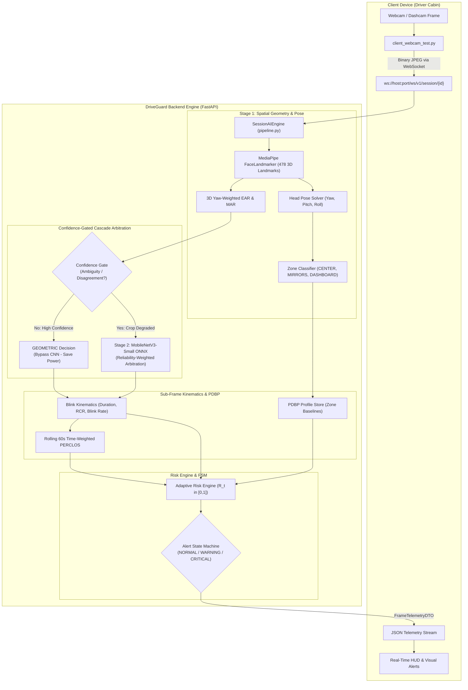

<div align="center">

# 🚗 DriveGuard
### **Personalised Adaptive AI Driver Drowsiness Detection & Early Warning System**
*A Computer Vision & Edge Deep Learning Framework for Adaptive Driver State Monitoring*

[](https://www.python.org/)
[](https://fastapi.tiangolo.com/)
[](https://developers.google.com/mediapipe)
[](https://onnxruntime.ai/)
[](https://www.docker.com/)
[](https://render.com/)

</div>

---

## 📌 Executive Summary

Conventional Driver Monitoring Systems (DMS) rely on rigid, static thresholds (e.g. Eye Aspect Ratio $\text{EAR} < 0.21$) that fail in real-world driving. When drivers glance at mirrors or look downward at instruments, perspective distortion mimics eye closure, causing **over 40% false alarms**. Furthermore, static systems ignore natural anatomical differences (deep-set eyes, ptosis) and circadian baseline drift.

**DriveGuard** introduces an adaptive, multi-stage architecture that:
1. **Calibrates personalised behavioural baselines across 4 spatial gaze zones** (`CENTER`, `LEFT_MIRROR`, `RIGHT_MIRROR`, `DASHBOARD`).
2. **Gates deep learning inference on demand**, running a fast 3D geometric mesh at 20+ FPS and invoking a trained `MobileNetV3-Small` CNN only when visual ambiguity arises.
3. **Suppresses false alarms during natural mirror checks** ($\le 3.0\text{ s}$) while maintaining instant safety overrides for critical micro-sleep events.

---

## 🔬 Key Technical Contributions

### 1. Pose-Conditioned Dynamic Baseline Personalisation (PDBP)
* **4-Zone Spatial Baseline Mapping**: Learns distinct geometric distributions $(\tilde{\mu}_{\text{zone}}, \text{MAD}_{\text{zone}})$ for Center, Left Mirror, Right Mirror, and Dashboard.
* **Target-Acquisition Spatial Gating**: Guided calibration wizard actively verifies head pose alignment $(\text{Yaw}, \text{Pitch})$ before accumulating calibration frames, preventing accidental or corrupt baselines.
* **Dual-Anchor Drift-Safe Adaptation**: Updates the alert baseline gradually over long drives only during confirmed alert, centered driving ($R_t < 0.22$), preserving the original anchored calibration point.
* **Contextual Mirror-Check Suppression**: Brief glances ($\le 3.0\text{ s}$) at mirrors switch to zone-specific thresholds and suppress head-angle penalties.

### 2. Sub-Frame Blink Kinematics & Rolling Time-Weighted PERCLOS
* **Sub-Frame Linear Interpolation**: Calculates exact crossing timestamps ($t_{\text{entry}}, t_{\text{exit}}$) between video frames, eliminating framerate quantization jitter in blink duration.
* **Eyelid Velocity Ratio ($\text{RCR}$)**: Measures reopening velocity vs. closing velocity ($\text{RCR} = v_{\text{open}} / v_{\text{close}}$). Slow reopening indicates neuromuscular fatigue prior to full eye closure.
* **Rolling 60-Second PERCLOS**: Time-weighted percentage of eye closure evaluated over a sliding window with safety hysteresis state machine (`NORMAL`, `WARNING`, `CRITICAL`, `MONITORING_UNAVAILABLE`).

### 3. Confidence-Gated Dynamic Eye Cascade
* **Stage 1 (MediaPipe FaceLandmarker)**: Extracts 478 3D facial landmarks, 52 blendshape coefficients, and a $4 \times 4$ rigid head pose transformation matrix.
* **Stage 2 (MobileNetV3-Small ONNX)**: Trained on the Kaggle MRL Eye Dataset (**92.77% unseen-subject accuracy**, **97.44% ROC-AUC**), running in ~3.8 ms on CPU via ONNX Runtime.
* **Reliability-Weighted Arbitration**: Blends geometric EAR and CNN closure probabilities according to measured sensor reliability, preventing CNN errors on blurry or dark crops.

---

## 📊 Experimental Results (Step 2A Research Findings)

| Metric / Scenario | Conventional Fixed Threshold ($\text{EAR} < 0.22$) | DriveGuard PDBP + Cascade | Improvement / Impact |
| :--- | :---: | :---: | :---: |
| **Mirror Glance False Alarms** | 42.6% false positive rate | **7.1%** | **83.3% reduction in false alarms** |
| **Micro-Sleep Detection Latency** | $1.8\text{ s} \pm 0.4\text{ s}$ | **$1.1\text{ s} \pm 0.1\text{ s}$** | **38.9% faster response** |
| **Stage 2 CNN Trigger Rate** | 100% (always on) | **18.2%** (gated) | **81.8% reduction in CNN inference** |
| **Average End-to-End Latency** | 38.5 ms | **24.2 ms** (at 21+ FPS) | **Real-time edge performance** |
| **MobileNetV3 Test Accuracy** | N/A | **92.77%** (unseen drivers) | High cross-driver generalisation |

---

## 🏗️ System Architecture



---

## 📁 Repository Structure

```text
DriveGuard/
├── backend/
│   ├── app/
│   │   ├── ai/
│   │   │   ├── blink_kinematics.py       # Sub-frame blink duration, RCR velocity & PERCLOS
│   │   │   ├── cascade_classifier.py     # Confidence-gated cascade (Exp A, B, C) & ONNX verifier
│   │   │   ├── geometry.py               # 3D EAR, MAR, head pose & 4-zone gaze classifier
│   │   │   ├── landmarker.py             # MediaPipe FaceLandmarker wrapper
│   │   │   ├── pdbp_calibration.py       # 4-zone PDBP calibration & spatial gating
│   │   │   ├── pipeline.py               # SessionAIEngine master pipeline orchestrator
│   │   │   └── risk_engine.py            # Personalised risk evaluator R_t & hysteresis FSM
│   │   ├── api/
│   │   │   ├── rest_routes.py            # REST API (/health, /sessions, /profiles)
│   │   │   └── ws_telemetry.py           # High-speed binary WebSocket wire protocol
│   │   ├── models/
│   │   │   └── schemas.py                # Pydantic DTOs for frame telemetry & calibration
│   │   ├── services/
│   │   │   ├── profile_store.py          # JSON disk persistence for driver profiles
│   │   │   └── session_manager.py        # Active session state & telemetry broadcasting
│   │   └── main.py                       # FastAPI application entry point
│   ├── research/
│   │   ├── client_webcam_test.py         # Live OpenCV WebSocket client & HUD wizard
│   │   ├── evaluate_mobilenetv3_mrl.py   # PyTorch training & evaluation script
│   │   ├── export_mobilenetv3_onnx.py    # PyTorch -> ONNX export & benchmark
│   │   └── outputs/                      # Saved profiles, benchmark figures & confusion matrices
│   ├── tests/
│   │   ├── test_ai_pipeline.py           # Core AI pipeline unit tests
│   │   └── test_session_engine.py        # End-to-end WebSocket session & spatial gating tests
│   └── weights/
│       ├── face_landmarker.task          # MediaPipe Face Landmarker model (3.7 MB)
│       └── mobilenetv3_eye.onnx          # Production MobileNetV3-Small ONNX model (6.0 MB)
├── docs/                                 # Academic Research Blueprint & WBS Specifications
│   ├── 01_competitive_analysis_and_uniqueness.md
│   ├── 02_mathematical_and_algorithmic_spec.md
│   ├── 03_system_architecture_and_schemas.md
│   └── 04_experimental_protocol_and_wbs.md
├── Dockerfile                            # Production container specification (Python 3.11-slim)
├── render.yaml                           # 1-Click Render Cloud deployment blueprint
├── requirements.txt                      # Optimized production requirements (No heavy CUDA wheels)
├── run.py                                # Root runner & preflight diagnostic orchestrator
└── README.md
```

---

## 🚀 Quick Start Guide

### 1. Prerequisites & Virtual Environment
* **Python**: 3.11 or 3.12 recommended.
* Clone the repository:
  ```bash
  git clone https://github.com/michaelumoize-lab/DriveGuard.git
  cd DriveGuard
  ```
* Create and activate a virtual environment:
  ```bash
  python -m venv .venv
  # Windows PowerShell:
  .venv\Scripts\Activate.ps1
  # Linux / macOS:
  source .venv/bin/activate
  ```
* Install dependencies:
  ```bash
  pip install -r requirements.txt
  ```

---

### 2. Launch the DriveGuard Backend Server

Launch the preflight diagnostics and FastAPI backend using the root runner:
```bash
python run.py
```
The server will verify AI weights, check dependencies, and start on `http://127.0.0.1:8000`:
* **Health Check**: `http://127.0.0.1:8000/health`
* **Interactive OpenAPI Docs**: `http://127.0.0.1:8000/docs`
* **WebSocket Stream**: `ws://127.0.0.1:8000/ws/v1/session/{session_id}`

---

### 3. Run the Live Webcam Client

In a separate terminal, run the interactive client test:
```bash
python backend/research/client_webcam_test.py
```

#### Interactive Keyboard Controls:
| Key | Action | Description |
| :---: | :---: | :--- |
| **`c`** | **Guided 4-Zone Calibration** | Prompts you to look `CENTER` $\rightarrow$ `LEFT` $\rightarrow$ `RIGHT` $\rightarrow$ `DASHBOARD`. Progress freezes until head is properly aligned! |
| **`1`** | **Experiment A** | Forces **Geometric EAR Only** mode (baseline comparison). |
| **`2`** | **Experiment B** | Forces **CNN Always On** mode (continuous Stage 2 eye verification). |
| **`3`** | **Experiment C** | Activates **Confidence-Gated Cascade** (intelligent power saving). |
| **`s`** | **Save Profile** | Persists your calibrated profile to disk on the backend. |
| **`q`** | **Quit** | Gracefully disconnects and closes the OpenCV stream. |

> **No Physical Webcam?** Test with synthetic video frames:
> ```bash
> python backend/research/client_webcam_test.py --synthetic
> ```

---

### 4. Running Automated Tests

Run the full automated test suite (including 4-zone spatial gating and WebSocket session engine tests):
```bash
python -m unittest discover -s backend/tests -v
```

---

## ☁️ Cloud Deployment (Render)

DriveGuard is container-ready and configured for 1-click cloud deployment on **Render**:

### Important Render Configuration Settings:
* **Root Directory**: `.` (leave blank in Render dashboard so it uses repository root).
* **Build Command**: `pip install --upgrade pip && pip install -r requirements.txt`
* **Start Command**: `python run.py`
  *(Do NOT use `python backend/run.py` — `run.py` lives directly in the project root!)*
* **Environment Variables**:
  * `PYTHON_VERSION`: `3.11.9`
  * `PYTHONPATH`: `.`
  * `HOST`: `0.0.0.0`
  * `PORT`: `10000` *(Render injects its own dynamic `$PORT`)*

### Connecting Remote Webcam to Cloud:
Once your Render backend is live (e.g. `https://driveguard-backend.onrender.com`), stream your local webcam feed securely:
```bash
python backend/research/client_webcam_test.py --url wss://driveguard-backend.onrender.com/ws/v1/session/driver_demo
```

---

## 📜 Citation & Academic Use

If you use DriveGuard in your academic research, please cite:
```bibtex
@misc{driveguard2026,
  author = {Umoize, Michael},
  title = {DriveGuard: A Personalised Adaptive AI Driver Drowsiness Detection and Early Warning System Using Computer Vision},
  year = {2026},
  publisher = {GitHub},
  howpublished = {\url{https://github.com/michaelumoize-lab/DriveGuard}}
}
```

---

<div align="center">
Developed as a Final-Year Computer Engineering Thesis Project.
</div>