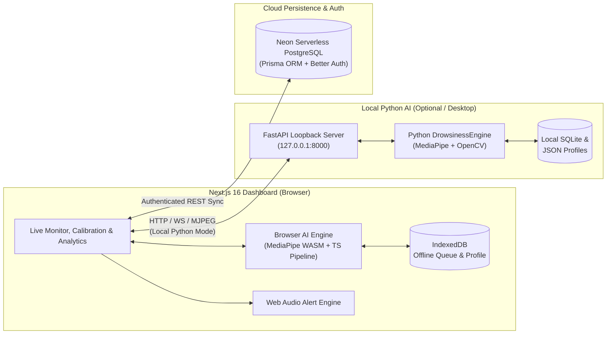

<div align="center">

# DriveGuard
### Personalized Real-Time AI Driver Drowsiness Detection & Early Warning System

*An academic full-stack driver monitoring platform combining personalized 4-zone facial baselines, 3D head-pose & ocular kinematics, and a verified dual-engine (Browser WASM + Local Python) runtime.*

[](https://drive-guard-mu.vercel.app)
[](https://nextjs.org/)
[](https://react.dev/)
[](https://www.typescriptlang.org/)
[](https://www.python.org/)
[](https://fastapi.tiangolo.com/)
[](https://developers.google.com/mediapipe)
[](https://neon.tech/)

</div>

---

## Overview

**DriveGuard** detects driver fatigue and distraction in real time before they escalate into critical road incidents.

Conventional drowsiness detectors rely on fixed global Eye Aspect Ratio (EAR) thresholds, which cause frequent false alarms for drivers with naturally narrower eyes or whenever a driver checks side mirrors and dashboard gauges. DriveGuard addresses this by learning each driver's **Personalized Driver Behaviour Profile (PDBP)** across four cockpit gaze zones (`CENTER`, `LEFT_MIRROR`, `RIGHT_MIRROR`, `DASHBOARD`), combining 3D head-pose estimation with temporal ocular kinematics (sub-frame blink duration, closure velocity, rolling 60-second PERCLOS, and yawn detection).

The same detection pipeline is implemented in both **TypeScript (on-device Browser WASM)** and **Python (OpenCV + FastAPI)** and verified by an automated cross-language golden parity harness (2,956 assertions across static poses, multi-frame fatigue sequences, and sensitivity presets).

---

## Key Features

- **Personalized 4-Zone Calibration (PDBP):** Learns each driver's resting open-eye median and scaled MAD across `CENTER`, `LEFT_MIRROR`, `RIGHT_MIRROR`, and `DASHBOARD`, with separate persisted profiles for Browser AI and Python AI.
- **Multi-Indicator Drowsiness & Distraction Engine:** Combines yaw/pitch-compensated **EAR**, **MAR** (yawn detection), **6-DoF Head Pose**, **rolling 60 s PERCLOS**, blink kinematics, and mirror-check dwell suppression (`<= 3 s` cap) into an explainable state machine (`NORMAL` → `ATTENTION` → `WARNING` → `CRITICAL`).
- **Dual-Engine Offline-Ready Runtime:**
  - **Browser AI (Default):** Runs 100% on-device via MediaPipe WASM in the browser with IndexedDB offline persistence and automatic Neon PostgreSQL sync.
  - **Local Python AI:** Runs natively on `127.0.0.1:8000` with direct OpenCV webcam/IP-phone capture, local SQLite storage, and a loopback-guarded FastAPI WebSocket/MJPEG bridge—plus standalone desktop launchers (`launchers/`).
  - **Remote LiveKit AI (Optional):** Supports WebRTC streaming to a remote Python worker when needed.
- **Low-Latency Safety Alerts:** Priority-managed Web Audio API synthesizer with instant silent teardown on stop/pause and configurable driver sensitivity presets (`RELAXED`, `STANDARD`, `HIGH`).
- **Analytics, Replay & Synthetic Testbench:** Authenticated driver dashboard (Better Auth + Neon PostgreSQL) with driving session history, alert timelines, and an isolated synthetic signal testbench.

---

## Architecture at a Glance



### Runtime Modes

| Mode | Where AI Runs | Camera Access | Works Offline? | Best For |
| :--- | :--- | :--- | :---: | :--- |
| **Browser AI** *(default)* | Client browser (MediaPipe WASM) | Browser `getUserMedia` | Yes | Zero-install web use & Vercel deployment |
| **Local Python AI** | Local FastAPI (`127.0.0.1:8000`) | Direct OpenCV / Phone IP stream | Yes | Local development & desktop benchmarking |
| **Desktop Launchers** | Standalone Python window | Direct OpenCV / Phone IP stream | Yes | Direct desktop webcam or phone-cam testing |
| **Remote LiveKit AI** | Remote Python WebRTC worker | WebRTC track via LiveKit SFU | No | Optional cloud-offloaded evaluation |

---

## Project Structure

```text
DriveGuard/
├── frontend/               # Next.js 16 dashboard, Prisma schema, and on-device Browser AI (lib/ai/)
├── backend/                # FastAPI service, Python DrowsinessEngine, and local SQLite persistence
├── launchers/              # Standalone desktop runtime entrypoints (webcam & IP camera)
├── scripts/validation/     # Cross-language Python ↔ TypeScript golden parity harness & fixtures
└── docs/                   # Mathematical specs, architecture docs & defense guide
```

---

## Validation & Quality Assurance

- **Cross-Language Golden Parity:** Automated verification harness validating identical outputs between the Python and TypeScript engines across static 6-DoF head poses, multi-frame fatigue scenarios, and sensitivity presets (2,956 assertions).
- **Automated Regression Suites:** Unit and integration tests covering ocular geometry, 4-zone calibration feasibility, mirror-check dwell suppression, alert storm protection, offline queue synchronization, and exclusive camera handoff.
- **Synthetic Signal Testbench:** Dedicated non-live simulator inside the dashboard for deterministic validation of microsleep, yawning, and distraction state transitions.

---

## Academic Documentation

Detailed engineering, algorithmic, and defense documentation lives in `docs/`:

| Document | Contents |
| :--- | :--- |
| [Mathematical & Algorithmic Spec](docs/02_mathematical_and_algorithmic_spec.md) | EAR/MAR geometry, PDBP median/MAD bounds, 6-DoF head pose & PERCLOS math |
| [System Architecture & Schemas](docs/03_system_architecture_and_schemas.md) | Data flows, telemetry contracts, and PostgreSQL schema design |
| [Academic Novelty & Defense Guide](docs/ACADEMIC_NOVELTY_AND_DEFENSE_GUIDE.md) | Research contributions, comparative analysis, and viva preparation |

---

## Future Work

- **Embedded Hardware Integration:** Physical microcontroller/in-cabin hardware alert subsystem — *yet to be implemented*.

---

## Safety Disclaimer & License

> [!WARNING]
> **Academic Research Prototype:** DriveGuard is developed for academic engineering research and evaluation. It is **not** certified to automotive functional safety standards (ISO 26262 / Euro NCAP) and must never be relied upon as a substitute for an alert driver.

All source code and documentation are maintained as an academic engineering project unless explicitly licensed otherwise.

---

<div align="center">
Developed by <b>Michael Umoize</b> · Computer Vision & Intelligent Transportation Systems
</div>
