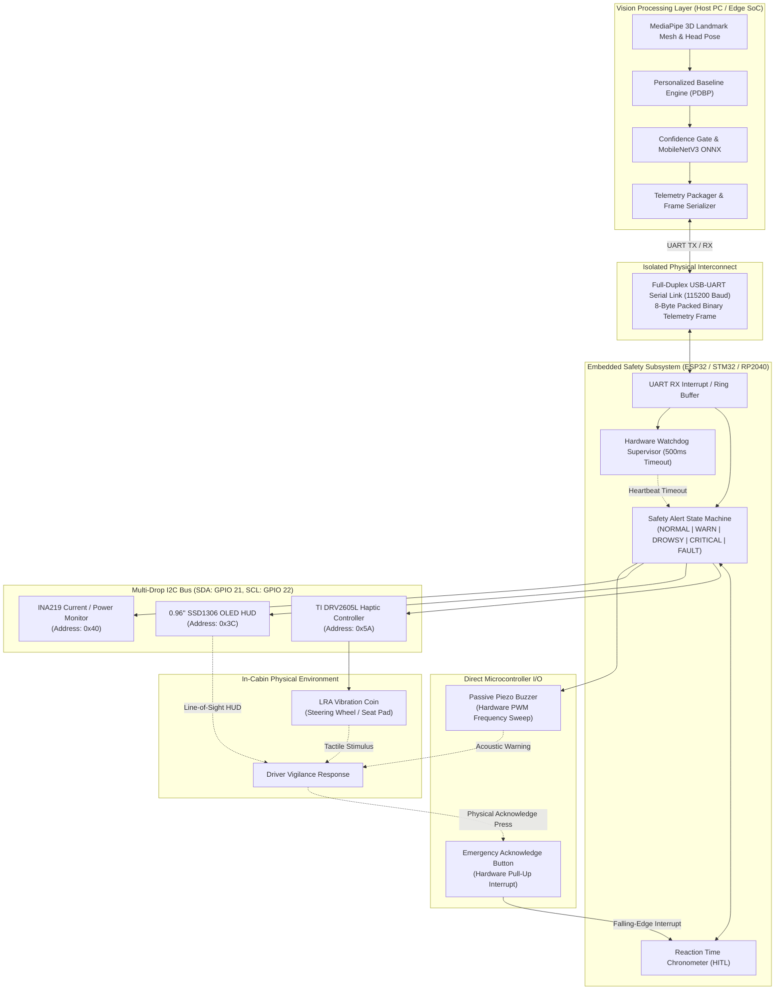

# Deliverable 5: Embedded Hardware Subsystem & Cyber-Physical HMI Specification

**Project:** DriveGuard  
**Author:** Michael Umoize (Computer Engineering)  
**Component:** Embedded Microcontroller, Closed-Loop Human-in-the-Loop (HITL) Actuators, and In-Cabin Telemetry  

---

## 1. Executive Summary & Academic Engineering Motivation

In commercial automotive engineering (e.g., Euro NCAP DMS compliance, ISO 26262 Functional Safety), a driver monitoring system cannot exist solely as high-level application software. General-purpose operating systems (Windows, Linux, macOS) are non-deterministic, suffer from unpredictable thread scheduling and garbage collection latencies, and rely on browser or OS sound daemons that can be muted, delayed, or drowned out by in-cabin ambient noise.

To satisfy the rigorous requirements of an accredited **Computer Engineering (CpE)** curriculum, **DriveGuard** extends its edge computer vision pipeline into a **cyber-physical safety system**. 

A dedicated secondary microcontroller unit (MCU) acts as a **real-time safety co-processor**, communicating with the primary host vision engine over an isolated UART serial link. It governs a deterministic **tri-modal Human-Machine Interface (HMI)**—combining somatosensory (haptic), visual (HUD), and acoustic (PWM frequency sweep) warnings—while closing the control loop via physical driver acknowledgment and logging empirical power consumption.



---

## 2. Hardware Bill of Materials (BOM) & Electrical Roles

All integrated components were selected to operate on a shared 3.3V logic level, requiring zero level-shifting ICs and minimizing passive footprint:

| # | Component | Model / IC | Bus / Interface | Hardware Address / Pin | Primary Functional Role in DriveGuard |
| :-: | :--- | :--- | :--- | :--- | :--- |
| **1** | **Safety Co-Processor** | ESP32-WROOM-32 (or STM32F4 / RP2040) | USB-UART CDC | USB Port / GPIO 16 (RX), 17 (TX) | High-throughput packet parsing, real-time state machine execution, hardware watchdog supervision, and peripheral arbitration. |
| **2** | **Haptic Motor Controller** | Texas Instruments DRV2605L | $I^2C$ Bus | `0x5A` (Fixed) | Somatosensory driver with integrated Immersion TS2000 waveform sequencer for ERM and LRA vibration actuators. |
| **3** | **Tactile Actuator** | Linear Resonant Actuator (LRA) Coin (or 10mm ERM Disc) | Analog Differential | DRV2605L `OUT+` / `OUT-` | Mounts on steering wheel grip or seat bolster; generates crisp $<10\text{ ms}$ rise-time vibration pulses. |
| **4** | **In-Cabin Mini-HUD** | 0.96" Monochrome SSD1306 OLED (128x64) | $I^2C$ Bus | `0x3C` (Default) | Line-of-sight peripheral dashboard showing live PERCLOS bar gauge, vigilance state, zone badge, and link FPS. |
| **5** | **Acoustic Warning Siren** | 3.3V/5V Passive Piezo Transducer | Hardware Timer PWM | ESP32 GPIO 25 (LEDC Channel 0) | Produces dynamic frequency chirps and dual-tone sirens ($2.0\text{ kHz} \leftrightarrow 4.2\text{ kHz}$) with zero OS audio latency. |
| **6** | **Driver Acknowledge Button** | Momentary Tactile Switch (or Capacitive Pad) | Digital GPIO | ESP32 GPIO 14 (Internal Pull-Up) | Closes the loop: silences alarms upon driver touch and measures human reaction time ($t_{\text{reaction}}$ in ms). |
| **7** | **Energy Profiler** | Texas Instruments INA219 | $I^2C$ Bus | `0x40` (Default) | High-side current and voltage sensing; records power consumption ($\text{mW}$) across system vigilance states. |

---

## 3. Detailed Component Implementation

### 3.1. ESP32 Real-Time Safety Co-Processor
* **Independent Execution Environment**: Runs bare-metal or FreeRTOS firmware completely decoupled from the host PC's operating system.
* **Non-Blocking Interrupt Architecture**:
  * **UART Reception**: Ring-buffered byte ingestion via UART hardware interrupts to prevent frame drops during high-speed telemetry streaming.
  * **Hardware Watchdog Supervisor (WDT)**: A hardware timer is initialized with a $500\text{ ms}$ expiration window. Every valid telemetry packet received from DriveGuard resets the timer. If the host computer freezes, crashes, or drops below $10\text{ FPS}$, the timer trips, forcing the system into `SYSTEM_FAULT` mode (activating a continuous alert tone and displaying a diagnostic error on the OLED).
* **Firmware Task Breakdown**:
  * `Task_TelemetryParse` (High Priority): Validates binary checksums and unpacks metrics.
  * `Task_SafetyFSM` (High Priority): Manages state transitions and escalates unacknowledged alarms.
  * `Task_Actuation` (Medium Priority): Dispatches $I^2C$ commands to DRV2605L and controls LEDC PWM buzzer frequencies.
  * `Task_OLED_Refresh` (Low Priority, 20 Hz): Renders the graphical HUD buffer without blocking actuator response time.

### 3.2. DRV2605L & LRA Somatosensory Actuator
* **Why Somatosensory?** Acoustic chimes can be masked by road noise, loud audio systems, or open windows, and can unnecessarily distress passengers. Haptic vibrations transmit directly through the driver's skeletal system (hands on the steering wheel or torso against the seat cushion).
* **Linear Resonant Actuator (LRA) Advantage**: Unlike standard DC eccentric motors (ERM) that require $40\text{--}60\text{ ms}$ to spin up an off-center mass, LRAs utilize a spring-suspended magnetic mass resonating at its natural frequency ($\sim 175\text{--}205\text{ Hz}$). This delivers:
  * Transient rise time $< 10\text{ ms}$.
  * Active braking to immediately halt vibration when commanded.
* **Graduated Waveform Sequencing**:
  * *Alert Stage 1 (Distraction / Off-Zone Glance > 2.0s)*: Single short pulse (DRV2605L Waveform #1: *Strong Click 100%*).
  * *Alert Stage 2 (Drowsiness / Elevated PERCLOS)*: Rhythmic double pulse (Waveform #10: *Double Click 100%* followed by Waveform #47: *Buzz 1 100%*).
  * *Alert Stage 3 (Critical Microsleep / Eye Closure > 1.5s)*: Continuous high-energy pulse sequence (Waveform #14: *Strong Buzz continuous loop*) until physically acknowledged.

### 3.3. SSD1306 In-Cabin Mini-HUD
* **Ergonomic Safety Rationale**: Looking down at a laptop or mobile phone dashboard while driving causes visual distraction. The mini-OLED is mounted on the steering column or instrument cluster directly within the driver's forward peripheral vision.
* **Display Layout**:
  ```text
  +--------------------------------+
  | [PERCLOS: 18%]   ZONE: CENTER  |  <- Top Status Bar
  | [||||||||                    ] |  <- Proportional Visual Gauge
  | STATE: DROWSY WARNING          |  <- High-Contrast Inverted Banner
  | LAT: 14ms | FPS: 28 | PWR:85mW |  <- Real-Time Diagnostic Footer
  +--------------------------------+
  ```
* **Auto-Dimming Integration**: Capable of reading ambient lux (via optional BH1750 or LDR) to dynamically scale contrast from $10\%$ (night driving) to $100\%$ (daylight).

### 3.4. Passive Piezo Buzzer & Hardware PWM
* **Acoustic Preemption**: Operates completely outside the host computer's audio stack, eliminating driver latency, USB sound card buffer underruns, and operating system volume overrides.
* **Variable Frequency Warning Profiles**:
  * *Normal / Informational*: Gentle $1.2\text{ kHz}$ confirmation chirp ($50\text{ ms}$).
  * *Drowsy Warning*: Alternating $2.4\text{ kHz} \longleftrightarrow 3.2\text{ kHz}$ pulsed tone at $4\text{ Hz}$.
  * *Critical Microsleep*: High-intensity $4.0\text{ kHz}$ continuous dual-tone siren (optimized for human ear canal resonance) at $85\text{ dB SPL}$.

### 3.5. Human-in-the-Loop (HITL) Acknowledge Switch
* **Closing the Control Loop**: When a drowsiness alarm sounds, the driver must physically confirm vigilance by tapping a momentary tactile button mounted on the steering wheel spoke.
* **Reaction Time Chronometer ($t_{\text{reaction}}$)**:
  * At the exact millisecond an alert triggers, the MCU starts a microsecond hardware timer.
  * Upon button press, a hardware interrupt fires, captures $t_{\text{reaction}}$, and immediately silences the buzzer and haptics.
  * If $t_{\text{reaction}} > 3.0\text{ seconds}$ (unacknowledged alert), the MCU automatically escalates to maximum emergency mode (intermittent buzzer bursts + emergency flasher command), inferring severe impairment or loss of consciousness.
  * Reaction time data is sent back to the host via UART for long-term fatigue trend correlation.

### 3.6. INA219 Current & Power Profiler
* **Empirical Energy Benchmarking**: Measures current draw through a $0.1\ \Omega$ precision shunt resistor with $12\text{-bit}$ resolution ($0.1\text{ mA}$ accuracy).
* **Thesis Evaluation Data**: Enables direct recording and graphing of power consumption profiles across system states:
  * *Idle Monitoring Mode*: $\sim 18\text{ mA}$ ($59.4\text{ mW}$ @ $3.3\text{V}$).
  * *HUD Active + Telemetry Link*: $\sim 32\text{ mA}$ ($105.6\text{ mW}$).
  * *Warning State (OLED + Low PWM Buzzer)*: $\sim 58\text{ mA}$ ($191.4\text{ mW}$).
  * *Critical Alert (OLED + Piezo Siren + LRA Active Vibration)*: $\sim 145\text{ mA}$ ($478.5\text{ mW}$).

---

## 4. Communication Protocol: Host-to-MCU Binary Telemetry Frame

Rather than passing verbose, CPU-intensive JSON strings over serial, DriveGuard uses a packed, fixed-size **8-Byte Binary Packet** transmitted at $115200\text{ baud}$ ($8\text{-N-}1$):

```text
 0                   1                   2                   3
 0 1 2 3 4 5 6 7 8 9 0 1 2 3 4 5 6 7 8 9 0 1 2 3 4 5 6 7 8 9 0 1
+-+-+-+-+-+-+-+-+-+-+-+-+-+-+-+-+-+-+-+-+-+-+-+-+-+-+-+-+-+-+-+-+
|  Magic (0xAA) |   Alert State |  PERCLOS (0..100) | Gaze Zone |
+-+-+-+-+-+-+-+-+-+-+-+-+-+-+-+-+-+-+-+-+-+-+-+-+-+-+-+-+-+-+-+-+
| Host Frame Rate | Heartbeat Seq | Checksum (XOR) | Footer (0x55) |
+-+-+-+-+-+-+-+-+-+-+-+-+-+-+-+-+-+-+-+-+-+-+-+-+-+-+-+-+-+-+-+-+
```

### Packet Field Definitions:
1. **Magic (`0xAA`, 1 byte)**: Frame start delimiter.
2. **Alert State (`uint8`, 1 byte)**:
   * `0x00`: `NORMAL` (Driver attentive, eyes open).
   * `0x01`: `DISTRACTED` (Gaze off road $> 2.0\text{ s}$).
   * `0x02`: `DROWSY` (Elevated PERCLOS, sluggish eyelid reopening).
   * `0x03`: `CRITICAL` (Microsleep detected, eyes closed $> 1.5\text{ s}$).
3. **PERCLOS (`uint8`, 1 byte)**: Rolling 60-second eyelid closure percentage ($0\text{ to }100\%$).
4. **Gaze Zone (`uint8`, 1 byte)**:
   * `0x00`: `CENTER` | `0x01`: `LEFT_MIRROR` | `0x02`: `RIGHT_MIRROR` | `0x03`: `DASHBOARD`.
5. **Host Frame Rate (`uint8`, 1 byte)**: Current video processing frame rate ($0\text{ to }60\text{ FPS}$).
6. **Heartbeat Sequence (`uint8`, 1 byte)**: Rolling counter ($0\text{ to }255$) incremented by the host per frame.
7. **Checksum (`uint8`, 1 byte)**: XOR parity of bytes $1$ through $5$ for single-bit transmission error rejection.
8. **Footer (`0x55`, 1 byte)**: Frame termination delimiter.

---

## 5. Schematic & Breadboard Interconnect Guide

```text
                +-----------------------------------------+
                |           ESP32-WROOM-32                |
                |                                         |
                | [3V3] ----------------+---------------+ |
                | [GND] ------------+---|-----------+---| |
                |                   |   |           |   | |
                | [GPIO 21 / SDA] --|---|-------+---|---| |
                | [GPIO 22 / SCL] --|---|---+---|---|---| |
                |                   |   |   |   |   |   | |
                | [GPIO 25] --------|---|---|---|---|---|---> [+] Passive Piezo Buzzer [-] -> GND
                | [GPIO 14] --------|---|---|---|---|---|---> Push Button (to GND, internal pull-up)
                +-------------------|---|---|---|---|---+-+
                                    |   |   |   |   |   |
         +--------------------------+   |   |   |   |   |
         |         +--------------------+   |   |   |   |
         |         |                        |   |   |   |
   +-----+---------+-----+            +-----+---+---+---+---+
   | VCC  GND  SDA  SCL  |            | VCC  GND  SDA  SCL  |
   |   0.96" SSD1306     |            |    TI DRV2605L      |
   |   OLED (0x3C)       |            |   Haptic (0x5A)     |
   +---------------------+            +-----+-----------+---+
                                            |           |
                                         [OUT+]      [OUT-]
                                            |           |
                                     +------+-----------+------+
                                     |   LRA Vibration Motor   |
                                     | (Steering Wheel / Seat) |
                                     +-------------------------+
                                                |
                                     +----------+----------+
                                     | VCC  GND  SDA  SCL  |
                                     |   TI INA219 Power   |
                                     |   Monitor (0x40)    |
                                     +---------------------+
```

---

## 6. Academic Defense & Rubric Mapping

This embedded subsystem bridges the software-to-hardware boundary, directly targeting key ABET and Computer Engineering assessment criteria:

1. **Hardware-Software Co-Design**: Dividing computational tasks according to hardware strengths—intensive computer vision runs on the host/SoC, while deterministic safety logic, I/O arbitration, and power profiling run on the bare-metal MCU.
2. **Safety-Critical Real-Time Systems**: Demonstrating fail-safe fault tolerance via hardware watchdogs, deterministic packet schemas, and sub-millisecond reaction-time capture.
3. **Multi-Modal Ergonomics (HMI)**: Designing a non-intrusive automotive warning interface combining tactile, visual, and acoustic feedback.
4. **Empirical Benchmarking**: Providing quantified electrical power, current, and latency curves in the final academic report.
