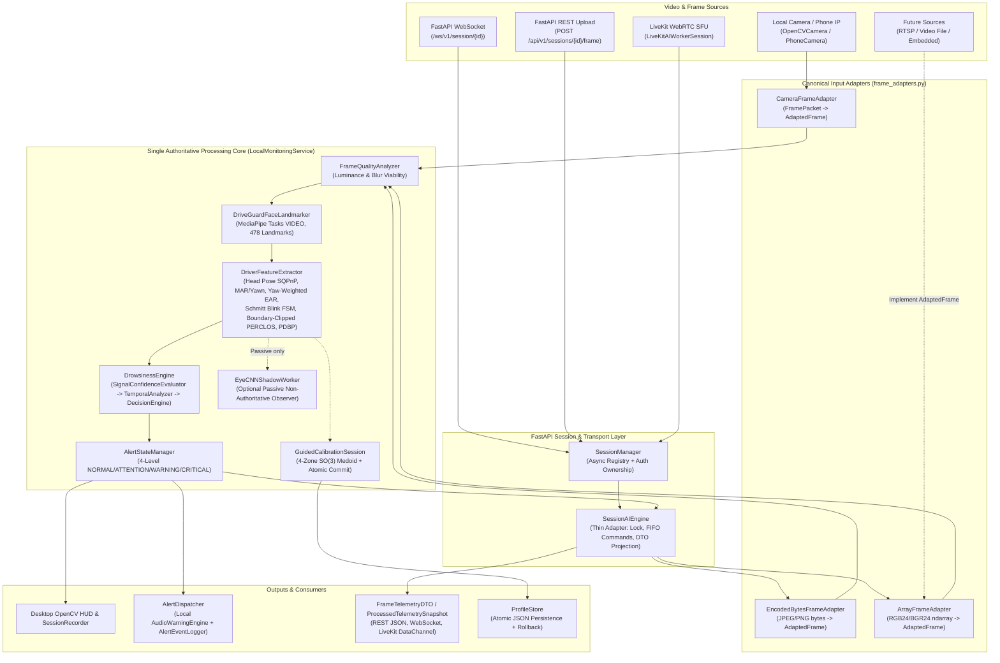

# DriveGuard — Consolidated System Architecture

**Status:** Authoritative Architecture (Post-Consolidation)  
**Primary Runtime:** Python 3.11 + FastAPI + Local-First OpenCV / MediaPipe  
**Authoritative Orchestrator:** `LocalMonitoringService` (`backend/app/services/local_monitoring_service.py`)  
**Authoritative Intelligence Core:** `DrowsinessEngine` (`backend/app/intelligence/drowsiness_engine.py`)

---

## 1. Architectural Overview

DriveGuard uses a **single authoritative drowsiness-detection pipeline** shared across every execution surface:

- **Local Webcam / Phone IP Camera CLI** (`scripts/run_camera_test.py`)
- **FastAPI REST API** (`POST /api/v1/sessions/{session_id}/frame`, `GET /api/v1/sessions/{session_id}/telemetry`, `/api/v1/sessions`, `/api/v1/calibration`, `/api/v1/profiles`)
- **FastAPI Binary WebSocket Stream** (`/ws/v1/session/{session_id}`)
- **LiveKit WebRTC SFU AI Worker** (`backend/app/services/livekit_worker.py`, `/api/v1/livekit/*`)

There is **one** `DriveGuardFaceLandmarker` (`backend/app/vision/face_landmarker.py`), **one** `DriverFeatureExtractor` (`backend/app/features/`), **one** `DrowsinessEngine` (`backend/app/intelligence/`), **one** `AlertStateManager` (`backend/app/alerts/`), and **one** shared orchestration service (`LocalMonitoringService`). FastAPI acts strictly as a transport, authentication, validation, and session-lifecycle layer and contains **no** duplicate EAR, blink, PERCLOS, MAR, head-pose, or drowsiness-scoring implementation.

---

## 2. Authoritative Processing Pipeline

Every frame entering `LocalMonitoringService.process_adapted_frame()` executes the same deterministic sequence:

1. **Frame Quality Analysis (`backend/app/camera/frame_quality.py`)**  
   Computes grayscale luminance and Laplacian blur variance to produce `FrameQualityResult` (`EXCELLENT`, `ACCEPTABLE`, `BLURRY`, `POOR_LIGHTING`, `UNUSABLE`, and `is_viable_for_inference`).
2. **Facial Landmark Localization (`backend/app/vision/face_landmarker.py`)**  
   Runs MediaPipe Tasks `FaceLandmarker` in `RunningMode.VIDEO`, enforcing strict monotonic millisecond timestamps, genuine landmark/framing confidence (`_estimate_landmark_confidence`), and frame-timestamp-driven face-loss grace handling (`FaceLandmarkResult`).
3. **Physiological Feature Extraction (`backend/app/features/feature_extractor.py`)**  
   Orchestrates:
   - `estimate_head_pose` (`head_pose.py`): rigid 5-point cranial SQPnP with 3D $SO(3)$ neutral-frame decoupling ($R_{\text{relative}} = R_{\text{neutral}}^T R_{\text{pnp}}$), mirror conjugation (`M @ R @ M`), and 6-zone classification with hysteresis.
   - `YawnDetector` (`mar.py`): inner-lip MAR with Schmitt hysteresis, 250 ms sampling-gap alignment, and bounded authentic yawn durations.
   - Safe-latch PDBP threshold switching (`validate_profile_feasibility` rejects `UNCALIBRATED_DEFAULT` / `sample_count == 0`).
   - `extract_eye_aspect_ratio` (`ear.py`): aspect-ratio-corrected 6-point EAR, C1-continuous yaw weighting, and bounded downward-pitch compensation.
   - `BlinkKinematicsDetector` (`blink_detector.py`): 6-state Schmitt-trigger hysteretic FSM preserving closure onset across single-frame EAR jitter, `REOPENING_TIMEOUT_MS = 1000 ms`, and sub-frame velocity/RCR kinematics.
   - `PerclosCalculator` (`perclos.py`): rolling 60 s time-weighted P80 with exact boundary clipping, 250 ms gap exclusion, and 50% coverage gating.
4. **Optional Calibration & Passive Shadow Side-Branches**  
   - `GuidedCalibrationSession` (`backend/app/ai/pdbp_calibration.py`) consumes raw uncompensated `weighted_ear`, genuine `compute_calibration_geometric_reliability()`, and 3D `rot_mat` for $SO(3)$ geodesic medoid aggregation.
   - `EyeCNNShadowWorker` (`backend/app/ai/eye_shadow_observer.py`) runs asynchronously on a daemon thread strictly as a passive diagnostic observer when enabled locally; it **never** feeds into or overrides drowsiness decisions.
5. **Drowsiness Intelligence (`backend/app/intelligence/drowsiness_engine.py`)**  
   - `SignalConfidenceEvaluator` (`confidence.py`) computes scalar confidence and independent channel viability (`head_pose_viable`, `ocular_viable`, `yawn_viable`).
   - `TemporalAnalyzer` (`temporal_analyzer.py`) tracks continuous eye closure (gated by channel-specific `ocular_viable`), nodding microsleep, rolling 30 s/60 s blinks and yawns, and off-road/downward head-orientation dwell.
   - `DecisionEngine` (`decision_engine.py`) arbitrates the 5-level `DrowsinessState` (`CRITICAL_WARNING > DROWSINESS_WARNING > ATTENTION > NORMAL`, plus `INSUFFICIENT_DATA`) with dual recovery timers and authoritative `is_alert_recovering`.
6. **Alert State Management (`backend/app/alerts/alert_state_manager.py`)**  
   Translates `DrowsinessAssessment` into discrete user-facing `AlertState` (`NORMAL`, `ATTENTION`, `WARNING`, `CRITICAL`) and `AlertTransition` events.
   - In **local desktop mode**, `AlertDispatcher` dispatches priority-ordered audio warnings (`AudioWarningEngine`) and UTC-timestamped JSONL records (`AlertEventLogger`).
   - In **headless FastAPI sessions**, `enable_audio=False` and `enable_event_logging=False` disable server-side speaker output while keeping `AlertStateManager` 100% active so clients receive authoritative alert states and trigger browser/hardware audio locally.

---

## 3. Role of Each Core Service

| Service / Module | File Path | Responsibility |
|---|---|---|
| **Frame Adapters** | `backend/app/services/frame_adapters.py` | Normalizes `FramePacket`, JPEG/PNG/WebP `bytes`, RGB24 arrays, and BGR24 arrays into validated `AdaptedFrame` envelopes. |
| **LocalMonitoringService** | `backend/app/services/local_monitoring_service.py` | Single authoritative pipeline orchestrator shared by local webcam scripts and FastAPI sessions. Produces `LocalMonitoringFrameResult` and zero-video `ProcessedTelemetrySnapshot`. |
| **SessionAIEngine** | `backend/app/ai/pipeline.py` | Thin per-session transport adapter around `LocalMonitoringService`. Owns `session_id`/`driver_id`/`owner_id`, `_process_lock`, FIFO frame-boundary command queue (`submit_command`), latency/FPS stats, and `FrameTelemetryDTO`/`CalibrationPhaseDTO` wire projection. |
| **SessionManager** | `backend/app/services/session_manager.py` | Async-safe in-memory registry of active `SessionAIEngine` instances with per-session landmarker isolation, ownership checks, profile auto-loading, and teardown cleanup. |
| **ProfileStore** | `backend/app/services/profile_store.py` | Thread-safe atomic JSON persistence for `DriverProfileDTO` with path sanitization, corrupt-file quarantine, and transactional rollback. |
| **WebSocket Telemetry** | `backend/app/api/ws_telemetry.py` | Authenticated bi-directional WebSocket handler (`/ws/v1/session/{session_id}`) with frame-size limits, idle timeouts, command dispatch, and disconnect cleanup. |
| **LiveKit AI Worker** | `backend/app/services/livekit_worker.py` | Autonomous WebRTC room participant subscribing to frontend camera tracks, maintaining a drop-oldest `maxsize=1` queue, running inference on a dedicated single-thread executor, and publishing telemetry & reliable `SAFETY_EVENT`s over DataChannels. |

---

## 4. How FastAPI Connects to the Authoritative Engine

1. **Application Startup (`backend/app/main.py`)**  
   FastAPI `lifespan()` calls `session_manager.preload_shared_models()`, which verifies `backend/weights/face_landmarker.task` via `backend.app.vision.face_landmarker.ensure_face_landmarker_model()`.
2. **Session Creation**  
   - REST `POST /api/v1/sessions` (or WebSocket connect / LiveKit worker start) authenticates the caller via HS256 JWT (`backend/app/core/auth.py`), verifies driver ownership, and calls `session_manager.get_or_create_session(...)`.
   - `SessionManager` instantiates an isolated `SessionAIEngine` in a worker thread (`asyncio.to_thread`), which creates its own headless `LocalMonitoringService` with an isolated `DriveGuardFaceLandmarker`, `DriverFeatureExtractor`, `DrowsinessEngine`, and `AlertStateManager`.
3. **Frame Ingestion**  
   - **REST Upload:** `POST /api/v1/sessions/{session_id}/frame` validates auth, ownership, non-empty payload, and `MAX_WS_FRAME_SIZE_BYTES`, then delegates to `await asyncio.to_thread(engine.process_frame, frame_bytes, timestamp_ms)`.
   - **WebSocket:** `/ws/v1/session/{session_id}` validates binary frame size and delegates to `await asyncio.to_thread(engine.process_frame, frame_bytes)`.
   - **LiveKit WebRTC:** `LiveKitAIWorkerSession._inference_loop()` converts `rtc.VideoFrame` to RGB24, normalizes width, and dispatches `engine.process_frame(norm_img, recv_mono_ms, is_rgb=True)` on its dedicated single-thread executor.
4. **Telemetry & Alert Retrieval**  
   - Per-frame calls return `FrameTelemetryDTO` containing wire-compatible `state`, `risk_score`, `eye_metrics`, `head_pose`, `reason_codes`, plus explicit authoritative fields (`drowsiness_state`, `alert_state`, `is_recovering`, `authoritative_engine="DrowsinessEngine"`).
   - `GET /api/v1/sessions/{session_id}/telemetry` exposes the latest `ProcessedTelemetrySnapshot` and `AlertStateManager` state on demand.
5. **Session Termination & Cleanup**  
   - `DELETE /api/v1/sessions/{session_id}`, WebSocket `WebSocketDisconnect`, or LiveKit `stop_worker()` calls `session_manager.terminate_session(session_id)`, which removes the session from the registry, persists calibrated profiles if applicable, aborts pending queued commands, and calls `engine.close()` → `monitoring_service.close()` → `landmarker.close()`.

---

## 5. How the Local Webcam Script Connects to the Engine

`scripts/run_camera_test.py` acts strictly as a desktop capture, HUD rendering, keyboard control, and recording harness:

1. Opens a local USB webcam (`OpenCVCamera`) or phone IP stream (`PhoneCamera`) via `backend/app/camera/camera_manager.create_camera()`.
2. Instantiates `LocalMonitoringService(config=LocalMonitoringConfig(...), store=profile_store)` with local audio warnings (`AudioWarningEngine`) and event logging (`AlertEventLogger`) enabled.
3. For each captured `FramePacket`, adapts it via `CameraFrameAdapter.adapt(packet, is_mirrored=is_mirrored)` and calls `monitoring_service.process_adapted_frame(adapted_frame)`.
4. Renders the non-mutating landmark overlay (`monitoring_service.landmarker.draw_landmarks`) and diagnostic HUD (`draw_diagnostic_hud`), optionally writing `frame_res.telemetry.to_dict()` to `SessionRecorder`.
5. On exit, calls `monitoring_service.close()` and `camera.stop()`.

---

## 6. WebSocket and LiveKit Architecture Status

| Integration | Status | Rationale |
|---|---|---|
| **LiveKit WebRTC (`/api/v1/livekit/*`, `livekit_worker.py`)** | **ACTIVE — RETAINED** | Required by the active Next.js frontend (`frontend/components/monitor/unified-live-monitor.tsx` and `frontend/components/calibration/guided-calibration-wizard.tsx` via `useLivekitTelemetryStream`) and Render deployment configuration (`render.yaml`). Now backed by the authoritative `LocalMonitoringService` through `SessionAIEngine`. |
| **Binary WebSocket (`/ws/v1/session/{session_id}`, `ws_telemetry.py`)** | **ACTIVE — RETAINED** | Provides lightweight, offline-capable direct frame streaming and JSON control commands without requiring external LiveKit Cloud SFU credentials; verified by API, security, and webcam client tests. Now backed by the authoritative `LocalMonitoringService`. |
| **REST Frame Ingestion & Telemetry (`/api/v1/sessions/{id}/frame`, `/telemetry`)** | **ACTIVE — ADDED** | Clean HTTP transport for single-frame uploads, stateless test harnesses, and future HTTP/edge adapters. |
| **Legacy `SessionAIEngine` Direct AI Stack (`ai.risk_engine`, `ai.blink_kinematics`, `ai.gaze_attention`, `ai.landmarker`, `ai.geometry`, `ai.cascade_classifier`)** | **ISOLATED TO `backend/app/ai/legacy/`** | Completely disconnected from FastAPI, WebSocket, LiveKit, `SessionManager`, `SessionAIEngine`, `LocalMonitoringService`, and `scripts/run_camera_test.py` (zero legacy modules loaded at startup; enforced by AST and fresh-process tests). Retained only via compatibility shims for offline research/benchmark scripts (see [TECHNICAL_DEBT.md](./TECHNICAL_DEBT.md)). |

---

## 7. Synchronised Next.js Frontend & LiveKit Browser Integration

The Next.js frontend (`frontend/`) communicates exclusively with FastAPI through:

- **Canonical Contracts & Reason Catalog (`frontend/types/telemetry.ts`):** Mirrors `FrameTelemetryDTO` (including `drowsiness_state`, `alert_state`, `is_recovering`, `authoritative_engine`), `CalibrationPhaseDTO`, `DriverProfileDTO`, unified `PoseZone`, all 16 authoritative `ReasonCode` entries, and `resolveEffectiveDisplayState()`.
- **Centralized API Client & Profile Mapper (`frontend/lib/api/driveguard-api.ts`, `frontend/lib/api/profile-mapper.ts`):** Authenticated requests in both cloud-proxy (`/api/v1/*`) and local (`http://127.0.0.1:8000` + Bearer JWT from `/api/auth/backend-token`) modes, plus canonical snake_case `DriverProfileDTO` serialization preserving `blink_rcr_median`, `blink_rcr_mad`, `neutral_rot_mat`, and `calibration_is_mirrored`.
- **LiveKit Primary Real-Time Transport (`frontend/hooks/use-livekit-telemetry-stream.ts`, `frontend/lib/livekit/livekit-session-client.ts`):** Publishes browser webcam tracks via LiveKit WebRTC with duplicate-publish mutex, explicit unpublish on disconnect, authenticated `POST /api/v1/livekit/stop-worker` teardown (including `pagehide` keepalive), `EVENT_ACK` reliable safety events, honest `backendProcessingStatus` / stale detection, and zero client-side drowsiness decision filtering.
- **Backend-Driven Calibration (`frontend/components/calibration/guided-calibration-wizard.tsx`):** Delegates all 4-zone spatial and 2-minute `BLINK_CADENCE` profiling directly to the backend `GuidedCalibrationSession` without client-side blink detectors or fabricated fallback profiles.
- **Unified `PoseZone` & Optional Desktop Audio:** `backend/app/schemas/telemetry.py` aliases `PoseZoneEnum` directly to `backend/app/features/head_pose.PoseZone` (with `math.isfinite()` guard preventing invalid poses from defaulting to `CENTER`). Desktop `sounddevice` playback is explicitly optional (`requirements-desktop-audio.txt`, `NullAudioBackend` headless fallback), while browsers use the Web Audio API.

---

## 8. Integrating Future Camera & Video Sources

To add a new video source (e.g., RTSP dashcam, Raspberry Pi CSI camera, offline MP4 replay, or embedded hardware frame bridge):

1. Add a lightweight adapter class/method in `backend/app/services/frame_adapters.py` that validates frame shape/dtype and emits an immutable `AdaptedFrame(frame_bgr, timestamp_ms, frame_width, frame_height, frame_index, source_id, is_mirrored)`.
2. Feed the `AdaptedFrame` directly into `LocalMonitoringService.process_adapted_frame(adapted)` (for local edge execution) or transmit encoded bytes/arrays to FastAPI (`POST /api/v1/sessions/{id}/frame` or `/ws/v1/session/{id}`).
3. Do **not** compute EAR, MAR, blinks, PERCLOS, head pose, or alert transitions inside the adapter or transport layer.
